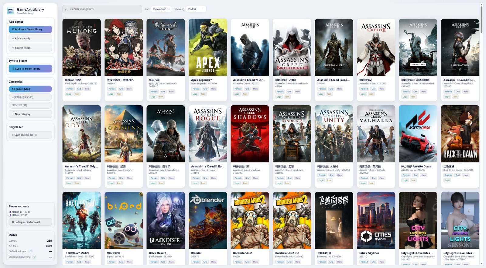
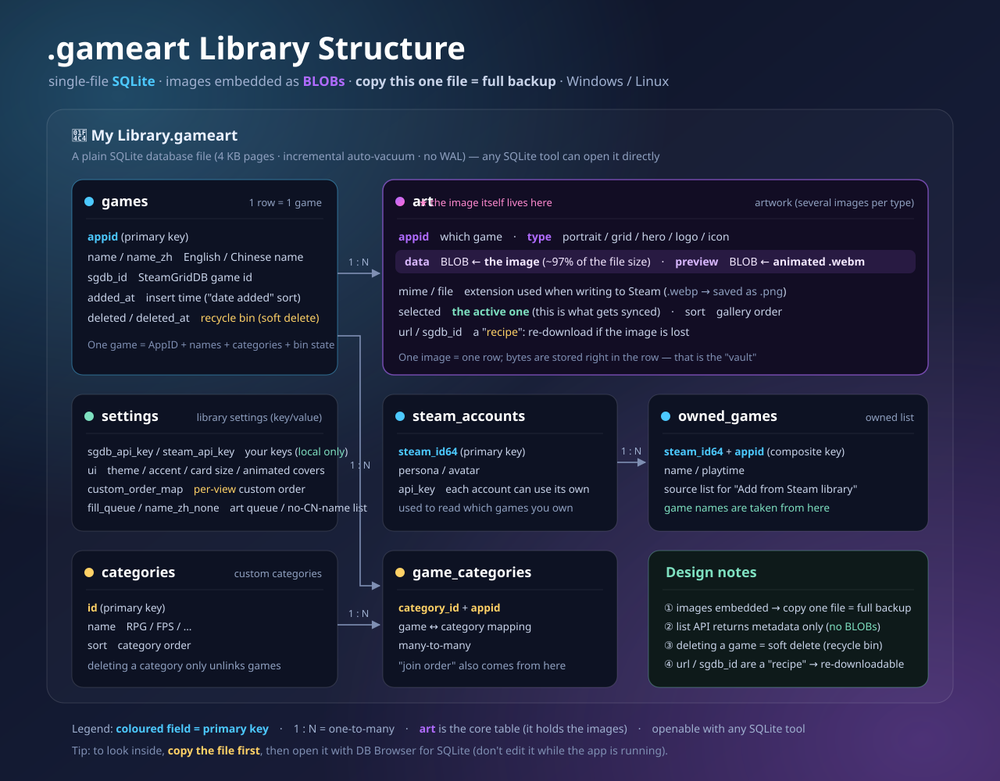
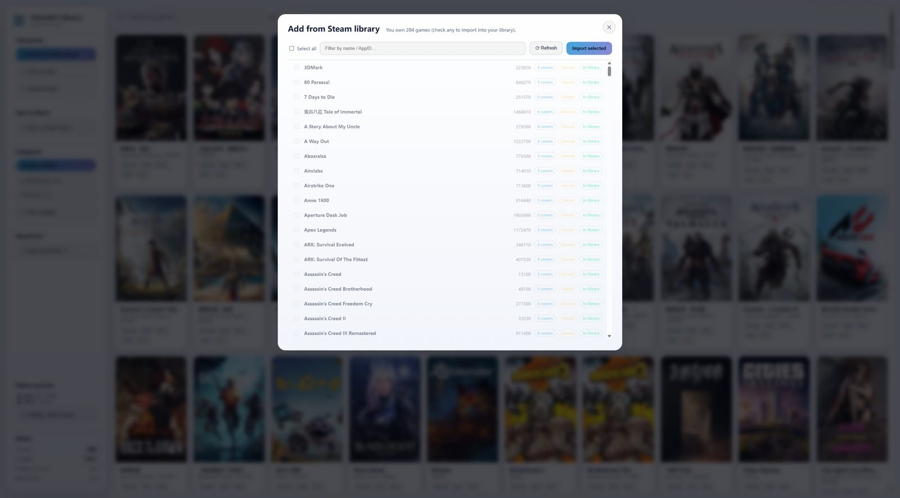
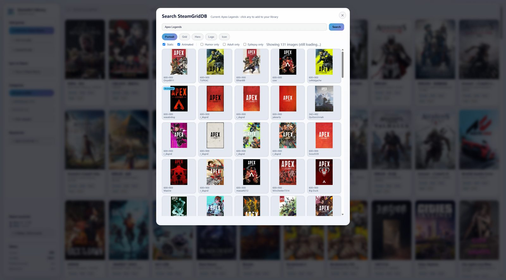
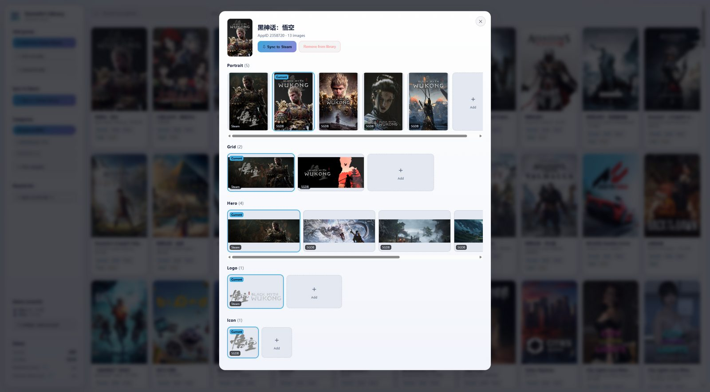
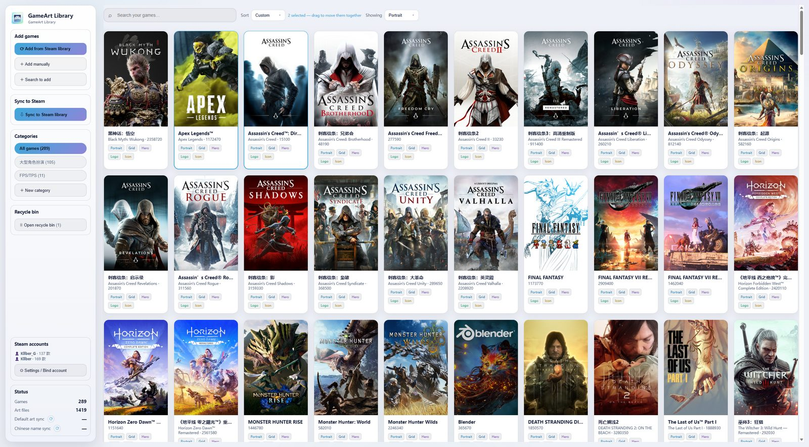
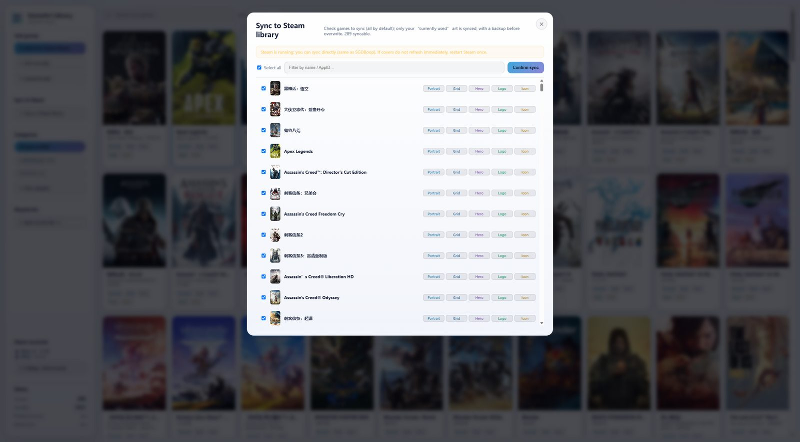
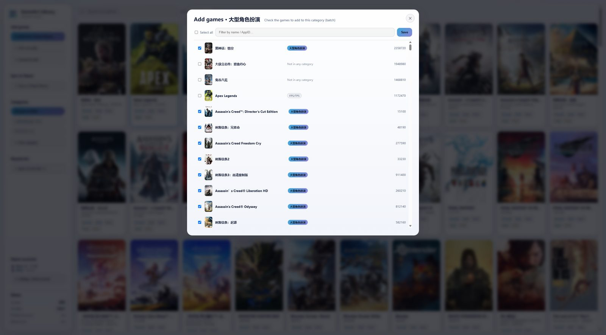
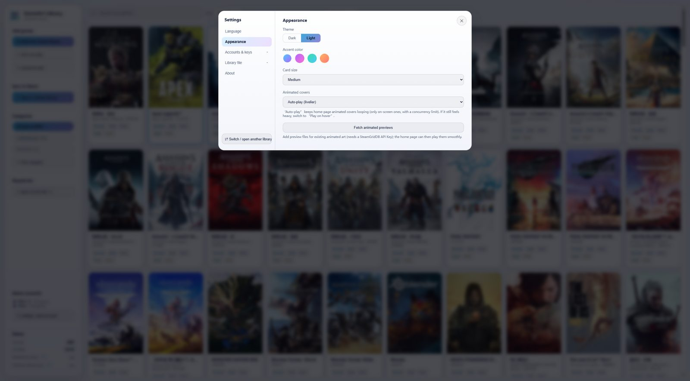

<div align="center">


<h1>GameArt Library</h1>

**Collect, back up and one-click apply your custom Steam artwork**

<p>
  
  
  
  
  
  
</p>

<p>
  <a href="./README.md">简体中文</a> ｜ <b>English</b>
</p>

<p>
  <a href="https://github.com/kllber/gameart-library/releases/latest">
    
  </a>
</p>

</div>

## 🎮 What is it?

GameArt Library keeps your **portrait covers, grids, hero banners, logos and icons** for every game in one place, backs them up, and **one-click applies them to Steam** (it writes into Steam's `config\grid`, exactly like Steam's built-in “set custom artwork”).

> Looks like a cover swapper; it's really **a vault for your game-art assets**:
> **keep it, find it, move it** — your effort stays in your own file, not in Steam's cache.

- **Local-first**: every artwork lives in your own **`.gameart`** file (images embedded as BLOBs) — copying that one file is a full backup.
- **BYOK**: the app ships **no API keys** and **no artwork**; everything comes from **your own** SteamGridDB API key and the Steam CDN.
- **Safe**: no injection, no hooks, no Steam client/memory patching; syncing only writes image files, with an automatic backup before overwriting.

## ✨ Features

### 🖼️ One dashboard for everything

See all your covers at a glance; the sidebar holds adding, syncing, categories, accounts and status. Sort by **date added / name / custom**, with search.



### 📦 Single-file vault `.gameart`

One SQLite container with **images embedded as BLOBs**: copy the file for a full backup, move it across machines, or keep several libraries and switch between them.

### 🗄️ What's inside the library file? (structure)

A `.gameart` file is just a **plain SQLite database** (no custom format) with **images embedded as BLOBs** — so **copying that single file is a complete backup**, and it opens on both Windows and Linux.



> 💡 **Want to look inside?** **Copy the file first**, then open it with [DB Browser for SQLite](https://sqlitebrowser.org/) (don't edit it while the app is running). Handy queries:
> `SELECT appid, name, name_zh FROM games WHERE COALESCE(deleted,0)=0;` (your games) ·
> `SELECT appid, type, COUNT(*) FROM art GROUP BY appid, type;` (how many art files per type)

### ⬇️ Add from your Steam library

Bind your Steam Web API key, and the app lists the games you **own** (with “has art / no art / owned / installed / in library” tags). Select and import — existing covers are filled in automatically.



### 🔎 SteamGridDB picker

Search a game → filter by **type** (static / animated) and **tags** (humor / adult / epilepsy) → click to add. Progressive loading (first page shows instantly), shared data for portrait/grid, **animated art plays on hover**, graceful fallbacks, and a progress status while adding.



### 🗂️ Detail gallery (multiple images / pick current / delete / reorder)

Keep several images per type: click to set the “current” one, ✕ to delete, drag to reorder. The “＋ Add” tile imports from SteamGridDB or from local images (**cropped to the right aspect ratio**).



### 🎨 Sort · “Show” type · Drag

- **Sort** (top bar): **date added / name / custom**. In “Custom”, **hold the left mouse button and drag covers** to reorder (like a photo album): drop into gaps, scroll with the wheel while dragging, `Ctrl`-click to multi-select and move a group; **each category keeps its own order**; dragging is disabled while searching.
- **Show** (top bar): choose which artwork to display on the cards — **Portrait / Grid / Hero / Logo / Icon**; the card shape and column count adapt automatically.
- **Category order**: just **drag the categories in the sidebar** up/down to reorder them (no extra panel).
- **Batch grouping**: `Ctrl`-click several games, then **right-click → Change groups** to add them **all** to a category at once.



### ↔️ One-click sync to Steam

Select in batch → only the **current** artwork of each type is written → **backup before overwrite**, **`<appid>.json` preserved**, **all accounts handled**. Syncing runs as a background task with progress.



### 🗂️ Categories & batch management

Custom categories in the sidebar (filter, rename, batch-add games); when batch-adding, **each row shows the categories the game already belongs to**.



### ⚙️ Chinese/English UI · dark/light theme · accent colors · card size

Switch UI language (Chinese/English) anytime; theme, accent color, card size, animated-cover playback and cache cleanup all live in Settings.



### 🧩 More

- **Recycle bin**: deleted games go there first — restore (with same-name/same-AppID conflict checks) or purge (which actually shrinks the library file).
- **Chinese game names** fetched from the Steam store on demand.
- **Cache-friendly**: all caches / backups / temp live inside the app folder (**never on C:**), with one-click cleanup.
- **Portable, no install**: the official Release is a run-anywhere zip.
- **`.gameart` file association**: double-click a library file to open it in the app (**Windows & Linux**).

## 🚀 Download

> **Open [Releases](https://github.com/kllber/gameart-library/releases/latest)** and grab the file for your OS.
> **No installation** — the runtime is bundled, **no Node.js needed**; `.gameart` files are **interchangeable** between Windows and Linux.

### 🪟 Windows 10 / 11 (64-bit)

| Step | Action |
|:--:|---|
| **1** | Download **`GameArtLibrary-vX.Y.Z-win-x64.zip`** |
| **2** | **Unzip** anywhere (right-click → Extract All) |
| **3** | Double-click **`游戏艺术库.exe`** |

| ✅ No install | ✅ Self-contained data | ✅ Nothing left behind |
|:--|:--|:--|
| No dependencies required | Caches/temp stay in the unzipped folder (`data\`, `tmp\`) | **Never writes to C:** — uninstall = delete the folder |

### 🐧 Linux (SteamOS / Bazzite / Fedora / Ubuntu …)

| Step | Action |
|:--:|---|
| **1** | Download **`GameArtLibrary-vX.Y.Z-linux-x86_64.tar.gz`** |
| **2** | **Extract it** (right-click → Extract) → you get a folder named **“游戏艺术库”** |
| **3** | Open it and **double-click the “游戏艺术库” launcher** → it just runs |

Inside the extracted folder:

```text
📁 游戏艺术库/
   ▶  游戏艺术库.desktop      ← double-click this (shows the app name + icon)
      游戏艺术库.AppImage     ← the actual program (you can double-click it too)
      游戏艺术库.png
      使用说明（先看我）.txt
```

> [!TIP]
> Execute permission is already set: **no commands, no install, no root**.
> The **first launch** asks whether to create a **desktop shortcut**; after that the app also appears in the **application menu** (right-click → pin to taskbar).
> If anything still shows a default icon, just **log out and back in** once.

| ✅ Desktop Mode | ✅ Both Steam builds | ✅ **Green / portable** |
|:--|:--|:--|
| Runs in Desktop Mode | Native **and** Flatpak Steam supported | **Data & caches live inside this folder** (`data/`, `tmp/`) — **move the whole folder anywhere**, the app follows |

> [!NOTE]
> - The **`.gameart` file association is automatic** (set up on first launch): double-click a library file to open it; it gets a **dedicated icon** too.
> - **Icons appear only after restarting Steam once**; covers / heroes / logos apply **immediately**.
> - No FUSE? Run with `APPIMAGE_EXTRACT_AND_RUN=1 ./GameArtLibrary-*.AppImage`.

### 🔑 Quick start (3 steps)

| Step | Do this |
|:--:|---|
| **1** | **Steam Web API** → Settings → Steam accounts → your [key](https://steamcommunity.com/dev/apikey) (account “Game details” must be **public**) |
| **2** | **SteamGridDB API** → Settings → SteamGridDB API → your [key](https://www.steamgriddb.com/profile/preferences/api) |
| **3** | **Add games** → sidebar “Add from Steam library / Search / Manual” → pick artwork → done |

## 🔒 Safety & privacy

- ✅ Sync **only writes images** into Steam's `userdata\<id>\config\grid` (identical to Steam's “set custom artwork”).
- ✅ **No injection / hooks / client or memory modification**; no VAC/DRM risk.
- ✅ Existing files are **backed up** to `data\backup\`; `<appid>.json` is preserved; all accounts handled uniformly.
- ✅ **Everything stays local — nothing is uploaded.**
- ⚠️ Cover/logo copyright belongs to their uploaders/publishers; **do not redistribute or use commercially**.

## 🛠️ Build from source

> Stack: **zero-dependency Node.js backend** (built-ins + `node:sqlite`) + **vanilla web frontend** (no framework, no build step) + **Electron** desktop shell. Business code depends on **no third-party libraries**.

```bat
dev.cmd npm install                :: install Electron (dev/packaging only)

:: Native window (recommended): double-click 启动游戏艺术库（原生窗口）.vbs

dev.cmd node src\server.js         :: backend + browser UI → http://127.0.0.1:5178
dev.cmd node tools\build-dist.js   :: build the portable distribution (分发版本/)
```

- Folders: `src/` (backend), `public/` (frontend), `desktop/` (Electron shell), `tools/` (icons / packaging / screenshot scripts).
- **All caches/temp stay inside the project** (`.cache/`, `.tmp/`, `data/`); run everything through `dev.cmd`.

## 📁 Where is my data?

| Location | Contents |
|---|---|
| your `*.gameart` | **artwork + games + categories + order + settings** (single file, images embedded; **interoperable** between Windows and Linux) |
| `data\` ／ `<the 游戏艺术库 folder>/data` | recent files, default-art cache, pre-sync backups, Electron cache |
| `tmp\` ／ `<the 游戏艺术库 folder>/tmp` | temp files for sync/download (auto-cleaned) |

> **Linux is portable too**: since v1.1.0, data & caches live **inside the app folder** — move the folder and everything follows. Older Linux builds used `~/.local/share/gameart-library`; the **first run migrates it automatically** (if the move fails, the old data simply stays put).

## ❓ FAQ

- **Steam didn't change after syncing?** Restart Steam once (covers are cached by Steam).
- **Icon changed but not showing?** For official Steam games the icon lives in Steam's icon cache — **restart Steam once**. Same for non-Steam shortcuts.
- **Can't fetch art / certificate error?** On corporate proxies, enable “**Fallback on certificate failure**” in Settings → SteamGridDB API.
- **Does it need internet?** Fetching art does; artwork already in your library works **offline**.
- **Can I share one `.gameart` between Windows and Linux?** Yes — the format is identical, just copy the file.

## ⚖️ License

**Apache-2.0** — see [`LICENSE`](./LICENSE). **Not affiliated with Valve/Steam or SteamGridDB.** All artwork is fetched from your own SteamGridDB account and remains under its authors' copyright; **personal use only**.
