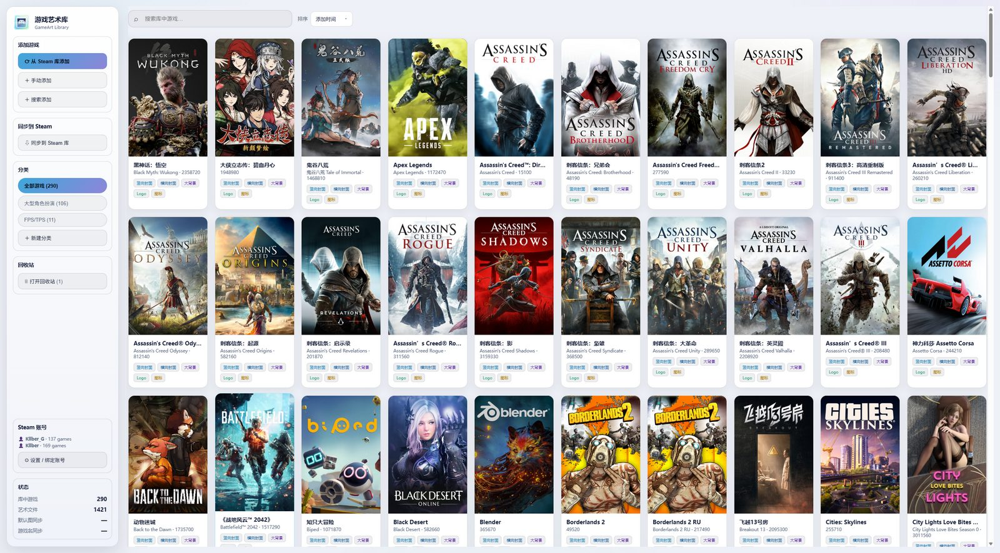
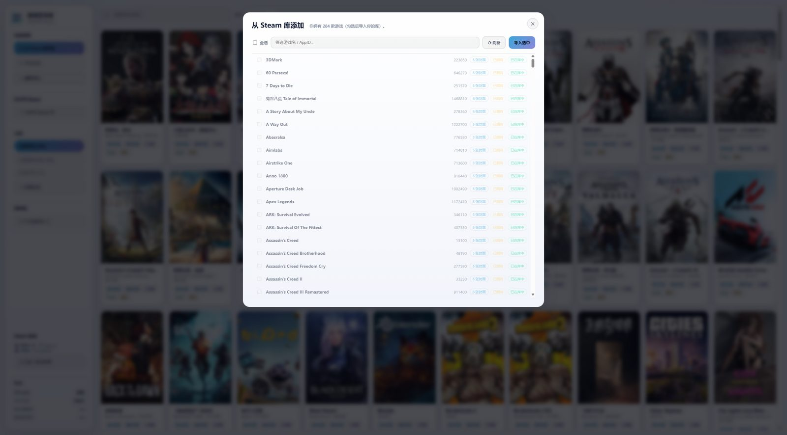
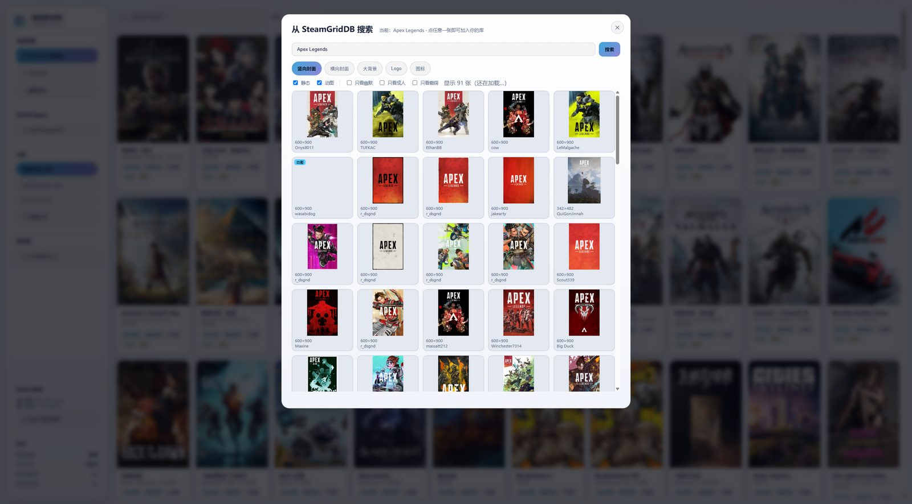
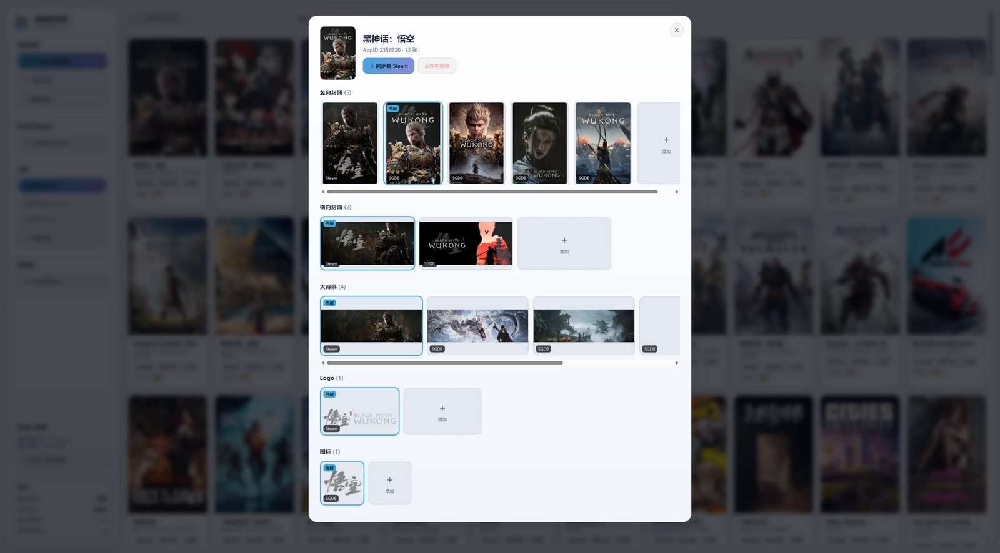
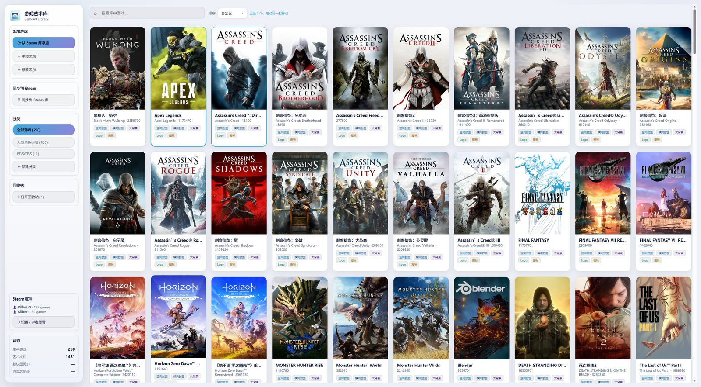
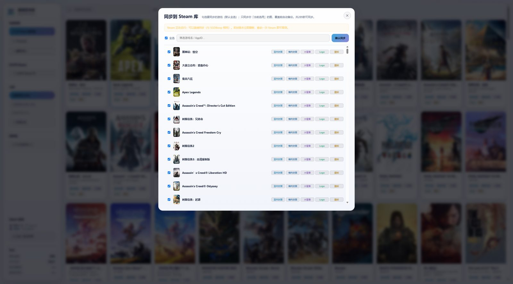
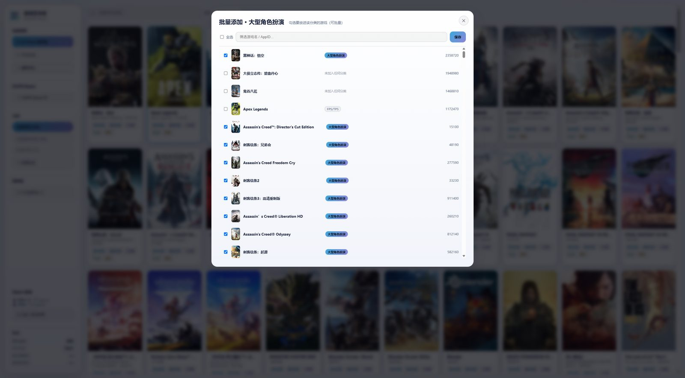
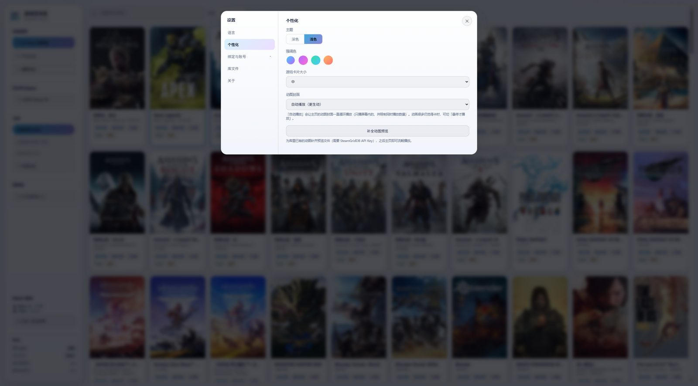

<div align="center">


<h1>游戏艺术库 · GameArt Library</h1>

**统一管理并一键同步你喜爱的游戏自定义艺术作品到 Steam**

<p>
  
  
  
  
  
</p>

<p>
  <b>简体中文</b> ｜ <a href="./README.en.md">English</a>
</p>

<p>
  <a href="https://github.com/kllber/gameart-library/releases/latest"><b>⬇ DOWNLOAD ｜ 下载 GAMEART LIBRARY</b></a>
</p>

</div>

## 🎮 游戏艺术库

把每款游戏的**竖向封面 / 横向封面 / 大背景(Hero) / Logo / 图标**集中收藏、备份，并**一键替换到 Steam**（写入 `config\grid`，等同于 Steam 自带的「设置自定义图片」）。

> 表面是「换封面工具」，本质是**我的游戏美术资产保险箱**：
> **存得住、找得回、搬得走、能对比**——心血留在自己的文件里，而不是散落在 Steam 缓存。

- **本地优先**：所有艺术图都存在你自己的 **`.gameart`** 单文件里（图片内嵌），复制这一个文件就是完整备份。
- **BYOK**：不内置、不打包任何 API Key，也不提供任何艺术作品；素材来自**你自己账号**的 SteamGridDB API 与 Steam CDN。
- **安全**：不注入、不 Hook、不改 Steam 程序或内存；同步只写图片文件，覆盖前自动备份。

## ✨ 主要特性

### 🖼️ 一个页面管好整座艺术馆

主页统一展示全部游戏封面，左侧是添加游戏、同步、分类、账号与状态；可按 **添加时间 / 名称 / 自定义** 排序，支持搜索。



### 📦 单文件保险箱 `.gameart`

一个 SQLite 容器，**图片以 BLOB 内嵌**：复制一个文件 = 完整备份，换电脑直接带走；也可随时「新建/打开/切换」不同库文件。

### ⬇️ 从 Steam 库添加

绑定 Steam Web API 后，一键列出你**已拥有**的游戏（显示“有封面/无封面/已拥有/已安装/已在库中”），勾选即导入，并自动补齐已有封面。



### 🔎 SteamGridDB 选图器

搜索游戏 → 按 **类型**（静态 / 动图）与 **标签**（幽默 / 成人 / 癫痫）筛选 → 点图即入库。渐进式加载（先出第一页）、竖向/横向共用一份数据、**动图悬停才播放**、加载失败自动回退、添加时底部显示进度。



### 🗂️ 详情画廊（多图 / 选用 / 删除 / 拖拽排序）

每类可保留多张，点图设为「当前选用」、✕ 删除、拖拽排序；底部「＋ 添加」可从 SteamGridDB 挑图或导入本地图片（**按比例裁切**）。



### 🎨 排序与自定义拖拽

「自定义」模式下可**按住左键拖拽**封面排序（类似手机相册）：可拖到空隙插入、拖拽中可滚轮翻页、`Ctrl` 点击多选后可整组拖动；**每个分类各有独立的排序**，互不干扰；搜索时会自动禁用拖拽以免顺序错乱。



### ↔️ 一键同步到 Steam

批量勾选 → 只写每类型**当前选用**的图 → **覆盖前自动备份**、**保留 `<appid>.json`**、**多账号统一写入**；同步为后台任务并显示进度。



### 🗂️ 分类与批量管理

侧栏自定义分类（可筛选、重命名、批量添加游戏）；**批量添加时每行会显示该游戏已加入的分类**，便于辨认归属。



### ⚙️ 中/英双语 · 深/浅主题 · 强调色 · 卡片大小

界面语言（中/英）随时切换；深/浅主题、强调色、卡片大小、动图封面播放策略与缓存清理都在设置里。



### 🧩 其它能力

- **回收站**：删除先进回收站，可恢复（检测同名/同 AppID 冲突）或彻底删除（真正缩小库文件）。
- **中文游戏名**：从 Steam 商店按需拉取并缓存。
- **缓存友好**：所有缓存 / 备份 / 临时文件都在程序目录内（**不写 C 盘**），可一键清理。
- **免安装便携版**：官方 Release 解压即用。
- **`.gameart` 文件关联**：双击库文件即可用本软件打开。

## 🚀 下载与安装

1. 打开 **[Releases](https://github.com/kllber/gameart-library/releases/latest)**，下载最新的 **`GameArtLibrary-vX.Y.Z-win-x64.zip`**；
2. **解压**到任意目录；
3. 双击解压出来的 **`游戏艺术库.exe`**。

- ✅ **无需安装**：运行环境已打包在文件夹内，**不需要 Node.js 或任何依赖**。
- ✅ **系统要求**：64 位 **Windows 10 / 11**。
- ✅ **缓存/临时都在该文件夹内**（`data\`、`tmp\`），**不写 C 盘**；想卸载，删掉整个文件夹即可。

### 首次使用（三步）

1. **Steam Web API**：设置 → Steam 账号 → 填 [Steam Web API Key](https://steamcommunity.com/dev/apikey) + SteamID/主页链接（账号「隐私设置 → 游戏详情」需**公开**）；
2. **SteamGridDB API**：设置 → SteamGridDB API → 填 [SteamGridDB API Key](https://www.steamgriddb.com/profile/preferences/api)；
3. **添加游戏**：侧栏「从 Steam 库添加 / 搜索添加 / 手动添加」→ 挑图 → 入库。

## 🔒 安全 · 隐私 · 合规

- ✅ 同步 = **只把图片写入 Steam 的 `userdata\<账号>\config\grid`**（与 Steam 自带的“设置自定义图片”完全一致）。
- ✅ **不注入、不 Hook、不改 Steam 可执行文件/内存**，不碰 VAC/DRM，**无封号风险**。
- ✅ **覆盖前自动备份**到 `data\backup\`；保留 `<appid>.json`；多账号统一处理。
- ✅ **数据只在本机**、**不上传**；`.gameart` 是你的私人文件，可随意复制/备份。
- ⚠️ 封面 / Logo 版权归上传者 / 发行商所有；**请勿再分发素材、勿商用**。

## 🛠️ 从源码运行 / 构建

> 技术栈：**后端零依赖 Node.js**（仅内置模块 + `node:sqlite`）+ **原生网页前端**（无框架、无构建）+ **Electron** 桌面外壳；业务代码**不依赖任何第三方库**。

```bat
dev.cmd npm install                :: 安装 Electron（仅开发/打包需要）

:: 原生窗口运行（推荐）：双击 启动游戏艺术库（原生窗口）.vbs

dev.cmd node src\server.js         :: 纯后端 + 浏览器调试 → http://127.0.0.1:5178
dev.cmd node tools\build-dist.js   :: 一键生成「免安装便携分发版」（分发版本/）
```

- 目录：`src/`（后端）、`public/`（前端）、`desktop/`（Electron 外壳）、`tools/`（图标 / 打包 / 截图脚本）。
- **所有缓存/临时文件都留在工程目录**（`.cache/`、`.tmp/`、`data/`），命令统一走 `dev.cmd`。

## 📁 数据都在哪？

| 位置 | 内容 |
|---|---|
| 你的 `*.gameart` | **艺术图 + 游戏 + 分类 + 排序 + 设置**（单文件，图片内嵌） |
| `data\` | 最近打开、默认图缓存、同步前备份、Electron 缓存 |
| `tmp\` | 同步/下载的临时文件（自动清理） |

## ❓ 常见问题

- **同步后 Steam 没变？** 重启一次 Steam 即可（封面由 Steam 缓存）。
- **抓不到封面 / 报证书错误？** 公司代理环境请在 设置 → SteamGridDB API 勾选「**证书失败时回退**」。
- **必须联网吗？** 抓封面需要联网；已入库的艺术图**离线也能看、能同步**。

## ⚖️ 许可与声明

- 本项目以 **Apache-2.0** 许可开源，见 [`LICENSE`](./LICENSE)。
- **与 Valve / Steam 及 SteamGridDB 无任何关联**；“Steam”、“SteamGridDB” 等商标归各自所有者。
- 本软件**不提供任何艺术作品**；素材来自用户自己账号的 SteamGridDB API 与 Steam CDN，版权归原作者/发行商。
- 请遵守 [Steam 订阅协议](https://store.steampowered.com/subscriber_agreement/) 与 [SteamGridDB 服务条款](https://www.steamgriddb.com/)；**仅供个人使用**。
