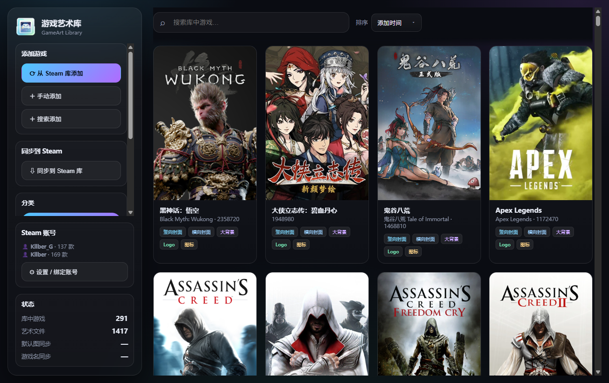
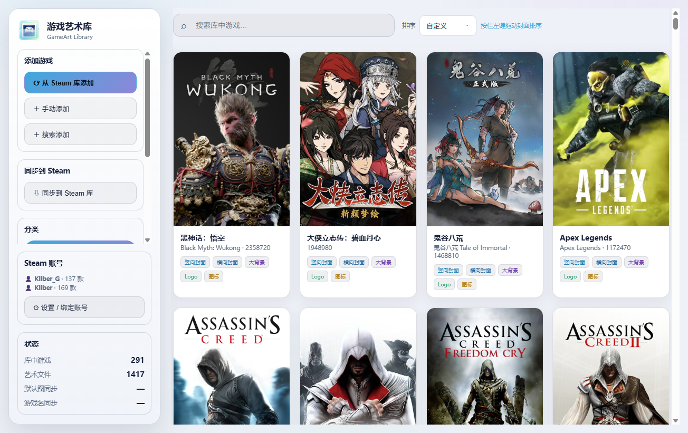
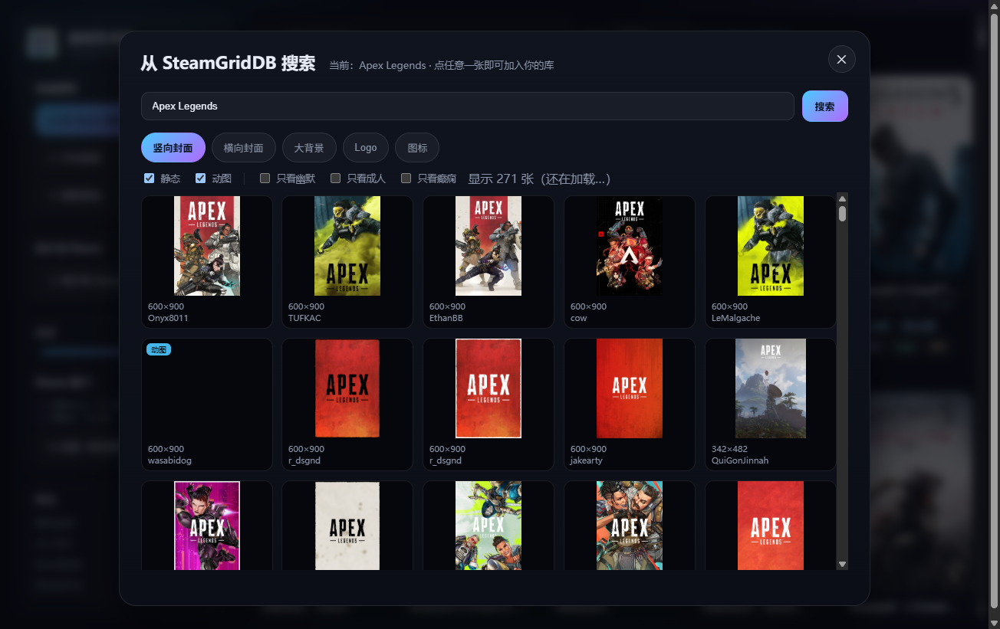
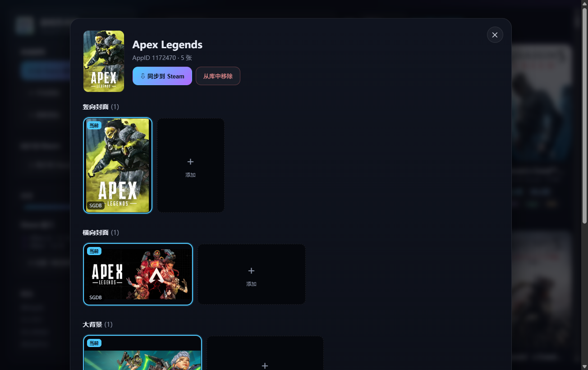
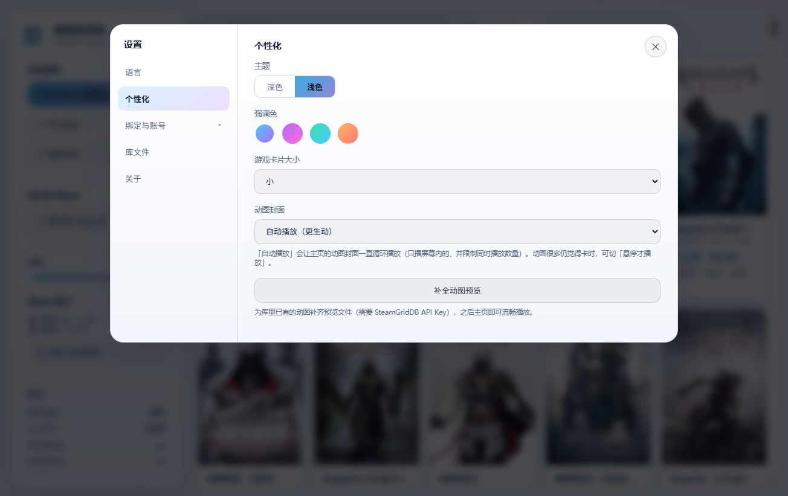

<div align="center">


<h1>游戏艺术库 · GameArt Library</h1>

**统一管理并一键同步你喜爱的游戏自定义艺术作品到 Steam**

<p>
  
  
  
  
  
</p>

<p>
  <a href="#简体中文">简体中文</a> ｜ <a href="#english">English</a>
</p>

<p>
  <a href="https://github.com/kllber/gameart-library/releases/latest"><b>⬇ DOWNLOAD ｜ 下载 GAMEART LIBRARY</b></a>
</p>

</div>



---

<div id="简体中文"></div>

# 🎮 游戏艺术库 · GameArt Library

一个**本地优先**的 Windows 桌面软件：把每款游戏的**竖向封面 / 横向封面 / 大背景(Hero) / Logo / 图标**集中收藏、备份，并**一键替换到 Steam**（写入 Steam 的 `config\grid`，等同于 Steam 自带的“设置自定义图片”）。

> 表面是「换封面工具」，本质是**我的游戏美术资产保险箱**。
> **存得住、找得回、搬得走、能对比**——把心血留在自己的文件里，而不是散落在 Steam 缓存中。

数据只在本机、只写你自己的 Steam 文件；**不注入、不 Hook、不改 Steam 程序或内存**，与 Valve / SteamGridDB 无任何关联。

> **English:** GameArt Library is a local-first Windows app to collect, back up and one-click apply your custom Steam artwork (covers/grids/heroes/logos/icons). All artwork lives in a single **`.gameart`** file on your disk. It never injects into or modifies Steam. Windows 10/11, no runtime dependencies required.

## ✨ 主要特性

- **🖼️ 五类艺术图集中管理**：竖向封面、横向封面、大背景、Logo、图标（每类可存多张，随时切换“当前选用”）。
- **🗃️ 单文件保险箱 `.gameart`**：一个 SQLite 容器，**图片以 BLOB 内嵌**——复制这一个文件就是完整备份，换电脑直接带走。
- **⬇️ 从 Steam 库添加**：读取你**已拥有**的游戏（Steam Web API），一键导入并自动补齐现有封面。
- **🔎 SteamGridDB 选图器**：搜索游戏 → 按 类型（静态/动图）与 标签（幽默/成人/癫痫）筛选 → 点图即入库；渐进式加载、动图悬停才播、加载失败自动回退。
- **✂️ 本地图片导入 + 按比例裁切**：封面 600×900、横向 920×430、大背景 1920×620、图标 512×512（Logo 不裁切）。
- **🎨 主页排序**：**添加时间 / 名称（按英文名，数字排最后）/ 自定义**；自定义模式可**按住左键拖拽**封面排序（支持拖到空隙插入、滚轮翻页、`Ctrl` 多选整组拖动）；**每个分类各有独立的排序**，互不干扰。
- **🔠 中文游戏名**：从 Steam 商店按需拉取并缓存（默认手动触发）。
- **↔️ 一键同步到 Steam**：批量选择 → 只写每类型**当前选用**的图 → **覆盖前自动备份**、**保留 `<appid>.json`**、**多账号统一写入**；同步为后台任务并显示进度。
- **🗑️ 回收站**：删除先进回收站，可恢复或彻底删除（恢复时检测同名/同 AppID 冲突）——彻底删除会真正缩小库文件。
- **🌗 中/英双语 + 深/浅主题 + 强调色 + 卡片大小**，界面风格统一。
- **🧹 缓存友好**：所有缓存/备份/临时文件都放在程序目录内（**不写 C 盘**），设置里可一键清理。
- **📦 免安装便携版**：官方 Releases 提供解压即用包（内置运行环境，Win10/11 双击启动）。

## 🖥️ 界面预览

| 深色主页 | 浅色主页 |
|---|---|
|  |  |

| SteamGridDB 选图 | 游戏详情（多图 / 选用 / 排序） |
|---|---|
|  |  |



## 🚀 下载与安装（普通用户）

1. 打开 **[Releases](https://github.com/kllber/gameart-library/releases/latest)**，下载最新的 `GameArtLibrary-vX.Y.Z-win-x64.zip`。
2. 解压到任意目录（建议不要放在需要管理员权限的位置）。
3. 双击解压出来的 **`游戏艺术库.exe`** 启动。

- **无需安装**：运行环境已打包在文件夹里，**不需要安装 Node.js 或任何依赖**。
- **系统要求**：64 位 **Windows 10 / 11**。
- **缓存/临时文件都在该文件夹内**（`data\`、`tmp\`），**不写 C 盘**；想彻底卸载，删掉整个文件夹即可。

### 首次使用（三步）

1. **绑定 Steam Web API**：设置 → Steam 账号 → 填 **Steam Web API Key**（[免费申请](https://steamcommunity.com/dev/apikey)）+ SteamID/主页链接，且账号「隐私设置 → 游戏详情」需**公开**；
2. **绑定 SteamGridDB API**：设置 → SteamGridDB API → 填 **SteamGridDB API Key**（[免费申请](https://www.steamgriddb.com/profile/preferences/api)）；
3. **添加游戏**：侧栏「从 Steam 库添加 / 搜索添加 / 手动添加」→ 挑图 → 入库。

> 🔑 **BYOK（自备 Key）**：本软件**不内置、不打包任何 API Key**，也不提供任何艺术作品；素材均来自**你自己账号**的 SteamGridDB API 与 Steam CDN。

## 🔒 安全 · 隐私 · 合规

- ✅ 同步 = **只把图片写入 Steam 的 `userdata\<账号>\config\grid`**（与 Steam 自带的“设置自定义图片”完全一致）。
- ✅ **不注入、不 Hook、不改 Steam 可执行文件/内存**，不碰 VAC/DRM，**无封号风险**。
- ✅ **覆盖前自动备份**到 `data\backup\`；保留 `<appid>.json`；多账号统一处理。
- ✅ **数据只在本机**、**不上传**；`.gameart` 是你的私人文件，可随意复制/备份。
- ⚠️ 封面 / Logo 版权归上传者 / 发行商；**请勿再分发素材、勿商用**。

## 🛠️ 从源码运行 / 构建

> 技术栈：**后端零依赖 Node.js**（仅内置模块 + `node:sqlite`）+ **原生网页前端**（无框架、无构建）+ **Electron** 桌面外壳。业务代码**不依赖任何第三方库**。

```bat
:: 1) 安装 Electron（仅开发/打包需要）
dev.cmd npm install

:: 2) 原生窗口运行（推荐）
::    双击 启动游戏艺术库（原生窗口）.vbs

:: 3) 纯后端 + 浏览器调试
dev.cmd node src\server.js
::    → http://127.0.0.1:5178

:: 4) 一键生成「免安装便携分发版」（分发版本/）
dev.cmd node tools\build-dist.js
```

- 目录：`src/`（后端）、`public/`（前端）、`desktop/`（Electron 外壳）、`tools/`（图标/打包脚本）。
- **所有缓存/临时文件都留在工程目录**（`.cache/`、`.tmp/`、`data/`），命令统一走 `dev.cmd`（会把 `TEMP/TMP` 指到工程内，**不写 C 盘**）。
- 详细设计、API 路由、数据模型与“踩过的坑”见 **[`维护约定.md`](./维护约定.md)**（本项目的单一事实来源）。

## 📁 数据都在哪？

| 位置 | 内容 |
|---|---|
| 你的 `*.gameart` | **艺术图 + 游戏 + 分类 + 排序 + 设置**（单文件，图片内嵌） |
| `data\` | 最近打开、默认图下载缓存、同步前备份、以及 Electron 的缓存 |
| `tmp\` | 同步/下载的临时文件（自动清理） |

## ❓ 常见问题

- **同步后 Steam 没变？** 重启一次 Steam 即可（封面由 Steam 缓存）。同步时可先退出 Steam 更稳妥。
- **抓不到封面 / 报证书错误？** 公司代理环境请在 设置 → SteamGridDB API 勾选「**证书失败时回退**」。
- **必须联网吗？** 抓封面需要联网；已有的艺术图**离线也能看、能同步**。

## ⚖️ 许可与声明

- 本项目以 **Apache-2.0** 许可开源，见 [`LICENSE`](./LICENSE)。
- **与 Valve / Steam 及 SteamGridDB 无任何关联**；“Steam”、“SteamGridDB” 等商标归各自所有者。
- 本软件**不提供任何艺术作品**；所有素材来自用户自己账号的 SteamGridDB API 与 Steam CDN，版权归原作者/发行商。
- 请遵守 [Steam 订阅协议](https://store.steampowered.com/subscriber_agreement/) 与 [SteamGridDB 服务条款](https://www.steamgriddb.com/)；**仅供个人使用**。

---

<div id="english"></div>

# 🎮 GameArt Library

A **local-first** Windows desktop app that collects, backs up and **one-click applies your custom Steam artwork** — portrait covers, grids, hero banners, logos and icons — by writing into Steam's `config\grid` (exactly like Steam's built-in “set custom artwork”).

> Looks like a cover swapper; it's really **a vault for your game-art assets**.
> **Keep it, find it, move it** — your effort stays in your own file, not in Steam's cache.

Nothing is injected into or modified in Steam; no memory hooks, no client patching. Not affiliated with Valve or SteamGridDB.

## ✨ Features

- **🖼️ Five artwork types**: portrait covers, grids, heroes, logos, icons (keep several per type, switch the “current” one anytime).
- **🗃️ Single-file vault `.gameart`**: one SQLite file with images embedded as BLOBs — copy that one file for a full backup.
- **⬇️ Add from your Steam library**: reads the games you **own** (Steam Web API) and fills in existing covers.
- **🔎 SteamGridDB picker**: search → filter by type (static/animated) and tags (humor/adult/epilepsy) → click to add; progressive loading, hover-to-play animated art, graceful fallbacks.
- **✂️ Import local images with aspect-ratio cropping** (600×900 / 920×430 / 1920×620 / 512×512; logos are not cropped).
- **🎨 Home sorting**: by **date added / name (English, digits last) / custom**; in custom mode **drag covers to reorder** (drop into gaps, scroll while dragging, `Ctrl`-click to multi-select and move a group). **Each category keeps its own order.**
- **🔠 Chinese game names** fetched and cached from the Steam store on demand.
- **↔️ One-click sync to Steam**: batch select → writes only the “current” art of each type → **backs up before overwrite**, **keeps `<appid>.json`**, **writes to all accounts**; runs as a background task with progress.
- **🗑️ Recycle bin**: soft-delete, restore (with conflict checks) or purge (which actually shrinks the library file).
- **🌗 Chinese/English UI, dark/light themes, accent colors, card sizes.**
- **🧹 Cache-friendly**: all caches/backups/temp stay inside the app folder (**never on C:**), with one-click cleanup.
- **📦 Portable, no install**: the official Release is a run-anywhere zip (bundled runtime).

## 🚀 Download

1. Grab `GameArtLibrary-vX.Y.Z-win-x64.zip` from **[Releases](https://github.com/kllber/gameart-library/releases/latest)**.
2. Unzip anywhere.
3. Run **`游戏艺术库.exe`**.

No installation, **no Node.js or dependencies required**; 64-bit **Windows 10 / 11**. Caches/temp live inside the folder (`data\`, `tmp\`) — **nothing is written to C:**. Uninstall by deleting the folder.

### Quick start (3 steps)

1. **Steam Web API** — Settings → Steam accounts → your [key](https://steamcommunity.com/dev/apikey) + SteamID/profile link (account “Game details” must be **public**).
2. **SteamGridDB API** — Settings → SteamGridDB API → your [key](https://www.steamgriddb.com/profile/preferences/api).
3. **Add games** — Add from Steam library / Search / Manual → pick artwork → done.

> 🔑 **BYOK**: the app ships **no API keys** and **no artwork**; everything comes from **your own** SteamGridDB API key and the Steam CDN.

## 🔒 Safety & privacy

- Sync **only writes images** into Steam's `userdata\<id>\config\grid` (same as Steam's “set custom artwork”).
- **No injection / hooks / client or memory modification**; no VAC/DRM risk.
- Existing files are **backed up** to `data\backup\`; `<appid>.json` is preserved; all accounts handled uniformly.
- **Everything stays local — nothing is uploaded.**

## 🛠️ Build from source

```bat
dev.cmd npm install            :: Electron (dev/packaging only)
dev.cmd node src\server.js     :: backend + browser UI (http://127.0.0.1:5178)
dev.cmd node tools\build-dist.js   :: build the portable distribution (分发版本/)
```

- Folders: `src/` (backend), `public/` (frontend), `desktop/` (Electron shell), `tools/` (icons/packaging).
- Design, data model, API routes and pitfalls are documented in **[`维护约定.md`](./维护约定.md)** (Chinese).

## 📄 License

**Apache-2.0** — see [`LICENSE`](./LICENSE). Not affiliated with Valve/Steam or SteamGridDB. All artwork is fetched from your own SteamGridDB account and remains under its authors' copyright; **personal use only**.
